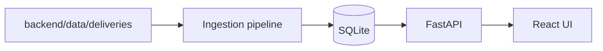

# Campaign Data Hub

Normalize weekly ad platform deliveries, assess data quality, and view campaign metrics in one place.

## Prerequisites

- Python 3.12+
- [uv](https://github.com/astral-sh/uv)
- Node.js 18+

## Setup

### Backend

```bash
cd backend
uv sync --extra dev
uv run uvicorn app.main:app --reload --port 8000
```

### Frontend

```bash
cd frontend
npm install
npm run dev
```

Open http://localhost:5173

### First run — ingest data

```bash
curl -X POST http://localhost:8000/api/v1/ingest
```

Or use **Run ingest** on the Data Health page.

## Architecture



**Storage:** SQLite — zero setup, fine for ~500 metric rows. Quality reports stored as JSON on `deliveries` (2 tables total).

**Ingestion:** Synchronous `POST /api/v1/ingest` — no background jobs. Full run or single file via `{ "filename": "..." }`.

## API endpoints

| Method | Path | Description |
|---|---|---|
| GET | `/api/v1/health` | Liveness |
| POST | `/api/v1/ingest` | Ingest all files or one file |
| GET | `/api/v1/metrics/campaigns` | Campaign metrics (filters, sort) |
| GET | `/api/v1/metrics/summary` | Totals for filters |
| GET | `/api/v1/metrics/by-platform` | Grouped by platform |
| GET | `/api/v1/deliveries` | List deliveries + health |
| GET | `/api/v1/deliveries/{id}/quality-report` | Full quality report |

## Quality checks implemented

| Check | What it catches in provided data |
|---|---|
| `duplicate_rows` | Google 06-01 — 8 duplicate campaign-day rows (keep first) |
| `duplicate_delivery` | Google 06-15 resend file |
| `date_parseable` / `date_valid_calendar` | Meta 06-01 row 23 (`06/31/2026`) |
| `row_required_fields` | Meta 06-15 missing clicks; LinkedIn missing fields |
| `numeric_non_negative` | Meta 06-22 negative spend |
| `spend_outlier` | Meta 06-08 ~100× spend spike |
| `campaign_name_variants` | Meta casing/whitespace variants |
| `cadence_missing_delivery` | Missing `linkedin_ads_2026-06-22.json` |
| `partial_week` | Week 06-29 (2 days only) |

## Design decisions

- **2 DB tables** — `deliveries` + `campaign_metrics`; quality report as JSON (YAGNI)
- **Campaign grouping** — `campaign_key = trim + casefold`; metrics API aggregates by key
- **Resend files** — first filename wins for metrics; duplicate flagged warn
- **No file upload** — reads from `backend/data/deliveries/` (FR-6 triggers pipeline, not upload)

## Tests

```bash
cd backend
uv run pytest tests/e2e -v
```

## Deferred (more time)

- Docker-compose
- Async ingest / background jobs for large files
- File upload API
- Separate `quality_checks` table for SQL analytics
