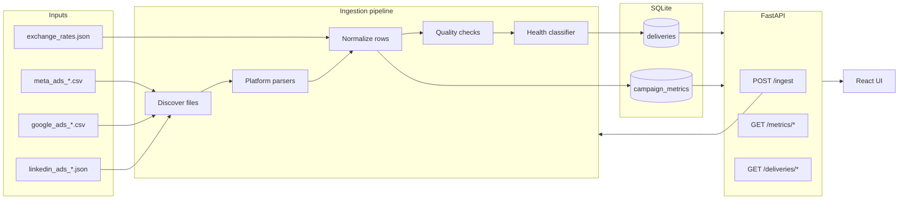

# Campaign Data Hub

[](https://github.com/ysskrishna/campaign-data-hub/blob/main/LICENSE) [](https://ysskrishna.space)

A full-stack ingestion and reporting system for weekly ad-platform deliveries. It normalizes Meta, Google, and LinkedIn exports into one canonical dataset, runs quality checks on every file, and surfaces both campaign metrics and delivery health in a single UI.

Built for the [Campaign Data Hub assessment](workspace/build-product/README.md).

## Quick start

From a fresh clone:

```bash
make install    # backend (uv) + frontend (npm) dependencies
make start      # API on :8000, UI on :5173
make ingest     # load backend/data/deliveries into SQLite
```

| Service | URL |
|---|---|
| Frontend | http://localhost:5173 |
| API (Swagger) | http://localhost:8000/docs |
| API (ReDoc) | http://localhost:8000/redoc |

Stop both servers with `make stop`.

### Manual setup (if you prefer)

```bash
# Backend
cd backend && uv sync --extra dev
uv run uvicorn app.main:app --reload --port 8000

# Frontend (separate terminal)
cd frontend && npm install && npm run dev

# First ingest
curl -X POST http://localhost:8000/api/v1/ingest
```

## Architecture



**Data flow:** `POST /api/v1/ingest` discovers files under `backend/data/deliveries/`, parses each platform's format, normalizes to `platform · campaign · date · spend_usd · impressions · clicks`, runs row/file/delivery checks, persists a quality report per file, and writes accepted rows to `campaign_metrics`. Re-ingesting is idempotent — same file hash and filename upsert in place.

## Storage

**SQLite** via SQLAlchemy. Two tables:

| Table | Purpose |
|---|---|
| `deliveries` | One row per file: health, row counts, quality report (JSON blob) |
| `campaign_metrics` | Normalized metric rows linked to a delivery |

SQLite needs no Docker or external service, handles ~500 metric rows comfortably, and keeps the submission runnable from a single `make install`. Quality reports are stored as JSON on `deliveries` rather than a separate `quality_checks` table — simpler for this scope; a dedicated table would help if we needed SQL analytics over check outcomes.

## API

Interactive OpenAPI docs are generated by FastAPI:

- **Swagger UI:** http://localhost:8000/docs
- **ReDoc:** http://localhost:8000/redoc

Key resources: campaign metrics (with platform/date filters, sort, totals), delivery health list, per-delivery quality report, and ingest trigger.

## Quality checks

Checks run at three levels during ingestion (`backend/app/pipeline/process.py`):

| Level | Check | Outcome in provided data |
|---|---|---|
| File | `file_readable` | All 15 files parse; would **fail** if CSV/JSON is corrupt |
| File | `duplicate_rows` | Google 06-01 — 8 duplicate campaign-day rows (keep first) |
| File | `campaign_name_variants` | Meta — casing/whitespace variants map to same `campaign_key` |
| File | `partial_week` | Week 06-29 (2 days only); Google 06-08 has fewer than 7 dates |
| Row | `date_in_week_window` | Row dates outside the delivery's week window |
| Row | `row_required_fields` | Meta 06-15 missing clicks; LinkedIn rows with missing fields |
| Row | `date_parseable` / `date_valid_calendar` | Meta 06-01 row 23 (`06/31/2026`) |
| Row | `currency_known` | Unknown currency codes |
| Row | `numeric_non_negative` | Meta 06-22 negative spend |
| Row | `spend_outlier` | Meta 06-08 ~100× spend spike (rejected, not just warned) |
| Delivery | `duplicate_delivery` | Google 06-15 resend file (non-canonical; metrics not counted) |
| Delivery | Cadence gap (post-ingest) | Missing `linkedin_ads_2026-06-22.json` — surfaced in ingest response and UI alert |

Rejected rows are dropped from metrics but recorded in the quality report with reason and raw payload.

## Health classification (pass / warn / fail)

Overall delivery health is computed in `backend/app/pipeline/quality/classifier.py`:

```
fail  →  any rejected row, OR any file-level check with outcome "fail"
warn  →  no fail, but at least one check with outcome "warn"
pass  →  everything else
```

| Health | When | Examples in provided data |
|---|---|---|
| **fail** | Unparseable file, or one or more rows rejected during validation | Meta 06-01 (invalid date), Meta 06-15 (missing clicks), Meta 06-22 (negative spend), Meta 06-08 (spend outlier) |
| **warn** | File ingested and all rows either accepted or only deduped, but a check flagged a concern | Google 06-01 (duplicate rows), Google 06-15 (duplicate delivery file), Meta (campaign name variants), week 06-29 (partial week) |
| **pass** | No rejected rows and no warn/fail checks | Clean Google and LinkedIn weeks |

The UI shows row counts as `accepted / raw` per file. Summary cards: **Passing** (delivery count by health), **Rows accepted** (`accepted / raw` with percentage), **Rejected rows** (total dropped across all files).

## Design decisions

- **Campaign grouping** — `campaign_key = trim + casefold`; metrics API aggregates by key so `"Summer Sale"` and `"summer sale "` roll up together.
- **Duplicate deliveries** — first filename wins for a `(platform, week)` slot; later files are ingested for audit but marked non-canonical with zero accepted rows for metrics.
- **Duplicate rows** — same `(campaign_key, date)` within a file: keep first, skip rest (warn, not fail).
- **Spend outliers** — rejected when spend > 10× the running median for that platform+campaign (prevents a single bad row from skewing totals).
- **Synchronous ingest** — `POST /ingest` runs inline; no job queue. Fine for 15 small weekly files.
- **No file upload** — FR-6 triggers the pipeline over files on disk, not an upload endpoint.
- **Error isolation** — a bad row or file never aborts the run; failures are recorded and processing continues (NFR-2).

## Tests

```bash
make test
# or: cd backend && uv run pytest tests/e2e -v
```

E2E tests cover: full ingest idempotency (run twice, same counts), expected health outcomes for planted defects, and normalized metric totals. Frontend smoke tests live in `frontend/e2e/`.

## What I'd do with more time

- `docker-compose.yml` for one-command bring-up
- Async ingest with progress for larger file sets
- File upload API for deliveries not already on disk
- Separate `quality_checks` table for SQL-level reporting
- Cadence-gap row in the deliveries table (synthetic "missing" delivery) so gaps appear in the health list without a separate alert

## Built and maintained by

Campaign Data Hub is built and maintained by:

| | Name | GitHub | Role |
|---|------|--------|------|
|  | **Y. Siva Sai Krishna** | [@ysskrishna](https://github.com/ysskrishna) | Creator |

## Support

If you find this project helpful:

- ⭐ Star the repository
- 🐛 [Report issues](https://github.com/ysskrishna/campaign-data-hub/issues)
- 🔀 Submit pull requests
- 💝 [Sponsor on GitHub](https://github.com/sponsors/ysskrishna)

## License

MIT © [Y. Siva Sai Krishna](https://github.com/ysskrishna) — see [LICENSE](LICENSE) for details.

---

<p align="left">
  <a href="https://github.com/ysskrishna">Author's GitHub</a> •
  <a href="https://linkedin.com/in/ysskrishna">Author's LinkedIn</a> •
  <a href="https://ysskrishna.space">Author's site</a> •
  <a href="https://github.com/ysskrishna/campaign-data-hub/issues">Report Issues</a>
</p>
